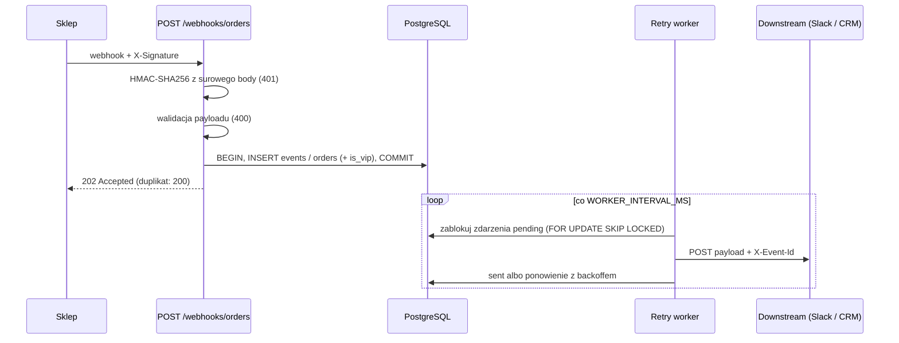

# order-webhook-relay

[](https://github.com/kamilszwaradzki/order-webhook-relay/actions/workflows/ci.yml)

Mały serwis integracyjny w Node.js/Express. Odbiera z serwisu sklepu webhook „nowe zamówienie”, weryfikuje jego podpis, zapisuje zdarzenie w PostgreSQL, stosuje regułę biznesową (VIP) i asynchronicznie przekazuje je dalej, ponawiając nieudane wysyłki.

**Stack:** Node.js, Express 5, PostgreSQL 16 (czysty SQL przez `pg`, bez ORM), zod, Jest + Supertest, Docker Compose.

## Przepływ



Webhook odpowiada od razu, gdy zdarzenie jest bezpiecznie zapisane. Wysyłka dalej odbywa się w tle, więc wolny albo niedostępny odbiorca nigdy nie opóźnia sklepu.

## Szybki start

Wymagania: Node.js 20+, Docker.

```bash
cp .env.example .env
docker compose up -d db
npm install
npm run dev
```

W drugim terminalu:

```bash
./scripts/send-webhook.sh                                  # 202 Accepted
./scripts/send-webhook.sh                                  # 200 OK: duplikat, nic nowego się nie zapisuje
./scripts/send-webhook.sh scripts/sample-order-small.json  # 202, zamówienie nie-VIP
```

Żeby zobaczyć, co dochodzi do odbiorcy, ustaw w `.env` zmienne `DOWNSTREAM_URL` i `DOWNSTREAM_VIP_URL` na dwa adresy z [webhook.site](https://webhook.site). Domyślne adresy `example.com` odrzucają żądanie, więc z nimi zobaczysz w akcji backoff i ostatecznie status `failed`.

Podgląd stanu:

```bash
docker compose exec db psql -U app -d app_db \
  -c "SELECT event_id, status, attempts, next_attempt_at, last_error FROM events"
```

### Ręczne podpisanie webhooka

[scripts/send-webhook.sh](scripts/send-webhook.sh) robi w zasadzie to samo:

```bash
SECRET=dev-secret-change-me
SIG=$(openssl dgst -sha256 -hmac "$SECRET" -binary scripts/sample-order.json | openssl base64 -A)

curl -i -X POST http://localhost:3000/webhooks/orders \
  -H "Content-Type: application/json" \
  -H "X-Signature: $SIG" \
  --data-binary @scripts/sample-order.json
```

Używaj `--data-binary`, a nie `-d`: `-d` usuwa znaki nowej linii, więc bajty się zmieniają i podpis przestaje się zgadzać.

## API

### `POST /webhooks/orders`

| Nagłówek | Wartość |
|---|---|
| `Content-Type` | `application/json` |
| `X-Signature` | `base64(HMAC-SHA256(WEBHOOK_SECRET, surowe body))` |

```json
{
  "event_id": "evt_001",
  "type": "order.created",
  "data": {
    "order_id": "ORD-1042",
    "customer_email": "jan@example.com",
    "total": "1299.00",
    "currency": "PLN"
  }
}
```

| Pole | Reguła |
|---|---|
| `event_id` | niepusty string, klucz idempotencji |
| `type` | dokładnie `order.created` |
| `data.order_id` | niepusty string |
| `data.customer_email` | string zawierający `@` |
| `data.total` | **string** dziesiętny, maks. `99999999.99` (zgodnie z `NUMERIC(10,2)`) |
| `data.currency` | opcjonalny, 3 wielkie litery, domyślnie `PLN` |

| Odpowiedź | Kiedy |
|---|---|
| `202 Accepted` | nowe zdarzenie zapisane, czeka na wysyłkę |
| `200 OK` | duplikat `event_id`, nic się nie zmienia |
| `400 Bad Request` | niepoprawny JSON albo walidacja, w odpowiedzi `details: [{ path, message }]` |
| `401 Unauthorized` | brak podpisu albo zły podpis |
| `500` | błąd infrastruktury: nadawca ponowi, a ponowienie jest bezpieczne |

### `GET /health`

`200` gdy baza odpowiada, `503` gdy nie.

## Logika biznesowa

**Reguła VIP:** zamówienie w `PLN` z `total` **większym niż** `VIP_THRESHOLD` (domyślnie `1000.00`) dostaje `is_vip = true` i trafia na `DOWNSTREAM_VIP_URL`, a nie na `DOWNSTREAM_URL`. `1000.00` nie jest więc VIP-em, a `1000.01` już jest. Zamówienia w innych walutach nigdy nie są VIP-ami, bo przeliczanie walut świadomie nie wchodzi w zakres MVP.

**Statusy zdarzenia:**

| Status | Znaczenie |
|---|---|
| `pending` | czeka na wysyłkę (albo na kolejną próbę, od `next_attempt_at`) |
| `processing` | zablokowane przez workera, wysyłka w toku |
| `sent` | dostarczone (odbiorca odpowiedział 2xx) |
| `failed` | wyczerpane próby, powód w `last_error` |
| `skipped` | nowy `event_id` dla zamówienia, które już istnieje: zapisane do audytu, nie wysyłane |

**Ponawianie:** po nieudanej wysyłce `next_attempt_at = now() + RETRY_BASE_DELAY_SECONDS × 2^(attempts − 1)`, czyli 10 s, 20 s, 40 s i 80 s przy domyślnych ustawieniach. Piąta nieudana próba (`MAX_RETRY_ATTEMPTS`) ustawia `failed`.

## Decyzje projektowe

- **HMAC z surowych bajtów.** Na trasie webhooka działa `express.raw()`, a nie `express.json()`. Ponowna serializacja sparsowanego JSON-a może zmienić kolejność kluczy, odstępy czy zapis liczb, a wtedy podpis przestaje się zgadzać. Podpisy są porównywane przez `crypto.timingSafeEqual`, po sprawdzeniu długości, żeby nie dało się przeprowadzić ataku czasowego.
- **Idempotencja w bazie.** `INSERT ... ON CONFLICT (event_id) DO NOTHING RETURNING id`. O duplikatach decyduje ograniczenie `UNIQUE`, a nie kod aplikacji, więc dwa identyczne requesty w tej samej milisekundzie też dają jeden wiersz. Duplikat dostaje `200`, bo nadawcy ponawiają wysyłki, i to jest normalna sytuacja.
- **Jedna transakcja.** `events` i `orders` są zapisywane na jednym kliencie z puli (`BEGIN`/`COMMIT`), zwalnianym w `finally`.
- **Pieniądze nigdy jako float.** `total` przychodzi jako string, jest przechowywany jako `NUMERIC(10,2)`, a regułę VIP sprawdza się na groszach jako liczbach całkowitych.
- **Surowy payload do audytu.** `events.payload` przechowuje payload dokładnie w takiej postaci, w jakiej przyszedł (zod usuwa nieznane pola, więc zwalidowana kopia trafia tylko do `orders`).
- **4xx dla złych danych, 5xx dla awarii.** Wiadomość, która nigdy nie przejdzie walidacji (np. zbyt duża kwota), musi dostać 4xx, bo inaczej nadawca ponawiałby ją w nieskończoność.
- **Blokowanie zdarzeń zamiast długich transakcji.** Worker w krótkiej transakcji blokuje paczkę wierszy przez `FOR UPDATE SKIP LOCKED` i oznacza je jako `processing`. HTTP-owe wywołanie odbywa się już poza transakcją. Wiele instancji workera może więc działać równolegle i nigdy nie weźmie tego samego zdarzenia. Zdarzenia porzucone przez worker, który padł, są przejmowane ponownie po `PROCESSING_LEASE_SECONDS`. Przy starcie aplikacja sprawdza, czy blokada trwa dłużej niż `DISPATCH_TIMEOUT_MS`.
- **Dostarczenie at-least-once.** Jeśli wysyłka się powiedzie, a zapis statusu `sent` nie, zdarzenie zostanie wysłane ponownie. Każde żądanie niesie nagłówek `X-Event-Id`, dzięki któremu odbiorca może odrzucić duplikaty.
- **Graceful shutdown.** Na `SIGINT`/`SIGTERM` worker przestaje pobierać nowe zdarzenia i czeka na zakończenie bieżącej wysyłki. Dopiero potem zamykają się serwer HTTP i pula połączeń.

## Testy

```bash
docker compose up -d db_test   # osobny Postgres na porcie 5433, dane w tmpfs
npm test
```

Te same testy uruchamia GitHub Actions ([.github/workflows/ci.yml](.github/workflows/ci.yml)) przy każdym pushu i pull requeście. Postgres działa tam jako service container, a migracja jest wykonywana przez `psql`. Osobny job sprawdza skrypty shellcheckiem.

Testy używają `DATABASE_URL_TEST`, czyszczą tabele przed każdym testem i odmawiają uruchomienia, jeśli nazwa bazy nie kończy się na `_test`.

Zakres testów: brak podpisu albo zły podpis (401), poprawny webhook (202 + zapisane wiersze), duplikat `event_id` (200, jeden wiersz), walidacja (400), reguła VIP, status `skipped`.

## Konfiguracja

| Zmienna | Domyślnie | Opis |
|---|---|---|
| `PORT` | `3000` | |
| `DATABASE_URL` | wymagana | |
| `DATABASE_URL_TEST` | wymagana w testach | używana, gdy `NODE_ENV=test` |
| `WEBHOOK_SECRET` | wymagana | sekret HMAC współdzielony ze sklepem |
| `DOWNSTREAM_URL` | wymagana | odbiorca zwykłych zamówień |
| `DOWNSTREAM_VIP_URL` | wymagana | odbiorca zamówień VIP |
| `VIP_THRESHOLD` | `1000.00` | |
| `DISPATCH_TIMEOUT_MS` | `5000` | timeout pojedynczej wysyłki |
| `MAX_RETRY_ATTEMPTS` | `5` | |
| `RETRY_BASE_DELAY_SECONDS` | `10` | |
| `WORKER_INTERVAL_MS` | `5000` | |
| `WORKER_BATCH_SIZE` | `10` | |
| `PROCESSING_LEASE_SECONDS` | `120` | musi być dłuższy niż `DISPATCH_TIMEOUT_MS` |

Konfiguracja jest walidowana przy starcie: brakująca albo niepoprawna wartość przerywa uruchomienie aplikacji.

## Struktura projektu

```
src/
├── app.js                  # aplikacja Express (bez listen, żeby dało się ją testować)
├── server.js               # listen + worker + graceful shutdown
├── config.js               # wczytywanie i walidacja zmiennych środowiskowych
├── db/
│   ├── pool.js
│   └── migrations/001_init.sql
├── middleware/verifySignature.js
├── routes/webhooks.js
├── schemas/orderEvent.js   # schemat zod
├── services/
│   ├── orderService.js     # transakcja + reguła VIP
│   └── dispatcher.js       # wysyłka HTTP do odbiorcy
└── workers/retryWorker.js
scripts/send-webhook.sh     # podpisuje i wysyła przykładowy webhook
```

## Znane ograniczenia

- Migracje są wykonywane przez `docker-entrypoint-initdb.d`, czyli tylko na pustej bazie. W produkcji użyłbym narzędzia do migracji z tabelą wersji (np. node-pg-migrate).
- Podpis nie zawiera znacznika czasu, więc nie ma ochrony przed atakiem powtórzeniowym poza idempotencją. Tak samo działają webhooki Shopify. Stripe dodaje timestamp z oknem tolerancji.
- `JSONB` normalizuje payload (kolejność kluczy, odstępy). Do ponownej weryfikacji podpisu później trzeba by przechowywać surowe body w kolumnie `BYTEA`.
- Zdarzenie przejęte po wygaśnięciu blokady nie zwiększa licznika `attempts`.

## W planach

- `GET /events?status=`, `GET /orders?status=`, `POST /events/:id/retry`
- Dockerfile i usługa `app` w `docker-compose.yaml`
- Prosty panel w Vue z listą zdarzeń i przyciskiem „ponów”
