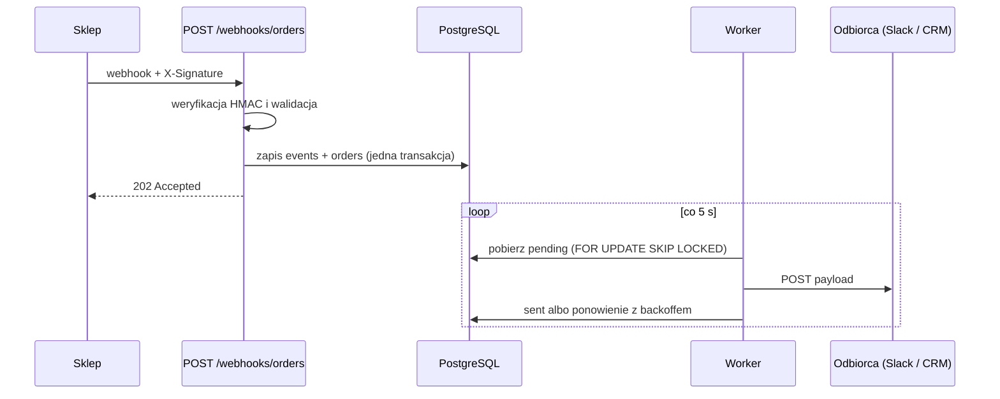

# order-webhook-relay

[](https://github.com/kamilszwaradzki/order-webhook-relay/actions/workflows/ci.yml)

Mały serwis integracyjny w Node.js/Express. Odbiera ze sklepu webhook „nowe zamówienie”, weryfikuje podpis, zapisuje zdarzenie w PostgreSQL, oznacza duże zamówienia jako VIP i w tle przekazuje je dalej, ponawiając nieudane wysyłki.

**Stack:** Node.js, Express 5, PostgreSQL 16 (czysty SQL przez `pg`), zod, Jest + Supertest, Docker Compose.

## Przepływ



## Uruchomienie

Wymagania: Node.js 20+ i Docker.

```bash
cp .env.example .env
docker compose up -d db
npm install
npm run dev
```

W drugim terminalu:

```bash
./scripts/send-webhook.sh                                  # 202 Accepted
./scripts/send-webhook.sh                                  # 200 OK, duplikat
./scripts/send-webhook.sh scripts/sample-order-small.json  # 202, zamówienie bez VIP
```

Żeby zobaczyć, co dochodzi do odbiorcy, ustaw w `.env` zmienne `DOWNSTREAM_URL` i `DOWNSTREAM_VIP_URL` na adresy z [webhook.site](https://webhook.site).

Ten sam webhook wysłany ręcznie:

```bash
SIG=$(openssl dgst -sha256 -hmac "dev-secret-change-me" -binary scripts/sample-order.json | openssl base64 -A)

curl -i -X POST http://localhost:3000/webhooks/orders \
  -H "Content-Type: application/json" \
  -H "X-Signature: $SIG" \
  --data-binary @scripts/sample-order.json
```

## API

`POST /webhooks/orders` z nagłówkiem `X-Signature`. Jego wartość to HMAC-SHA256 z surowego body, zakodowany w base64.

```json
{
  "event_id": "evt_001",
  "type": "order.created",
  "data": {
    "order_id": "ORD-1042",
    "customer_email": "jan@example.com",
    "total": "1299.00",
    "currency": "PLN"
  }
}
```

Odpowiedzi:
- **202**: zdarzenie zapisane;
- **200**: duplikat `event_id`;
- **400**: niepoprawny payload;
- **401**: zły podpis.

`GET /health` sprawdza połączenie z bazą.

## Jak to działa

- **Podpis** jest liczony z surowych bajtów (`express.raw`). Po sparsowaniu JSON-a bajty mogą się zmienić. Porównanie przez `crypto.timingSafeEqual`.
- **Idempotencja**: `INSERT ... ON CONFLICT (event_id) DO NOTHING`. Duplikaty odrzuca ograniczenie `UNIQUE` w bazie, więc działa to także przy równoczesnych requestach.
- **VIP**: zamówienie w PLN powyżej `VIP_THRESHOLD` (domyślnie 1000 zł) trafia na `DOWNSTREAM_VIP_URL`. Kwoty są stringami i `NUMERIC`, nigdy floatem.
- **Ponawianie**: po błędzie kolejna próba następuje po 10, 20, 40 i 80 s. Po piątej nieudanej próbie zdarzenie dostaje status `failed`, a powód trafia do `last_error`.
- **Wiele workerów**: `FOR UPDATE SKIP LOCKED` sprawia, że dwa procesy nie wezmą tego samego zdarzenia. Wysyłka HTTP odbywa się poza transakcją.
- **At-least-once**: każde żądanie do odbiorcy niesie nagłówek `X-Event-Id`, żeby odbiorca mógł odrzucić ewentualny duplikat.
- **Nowe zdarzenie dla istniejącego zamówienia** zostaje zapisane jako `skipped` i nie jest wysyłane drugi raz.

## Testy

```bash
docker compose up -d db_test   # osobny Postgres na porcie 5433
npm test
```

Sprawdzane są: zły podpis, duplikaty, walidacja, reguła VIP i status `skipped`. Te same testy uruchamia GitHub Actions przy każdym pushu.

## Konfiguracja

Wszystkie zmienne z wartościami domyślnymi są w [.env.example](.env.example). Najważniejsze to `DATABASE_URL`, `WEBHOOK_SECRET`, `DOWNSTREAM_URL`, `DOWNSTREAM_VIP_URL` i `VIP_THRESHOLD`. Niepoprawna konfiguracja przerywa start aplikacji.

## Ograniczenia

- Migracje wykonują się tylko na pustej bazie (`docker-entrypoint-initdb.d`). Na produkcji użyłbym narzędzia do migracji.
- Brak ochrony przed powtórzeniem starego webhooka poza idempotencją, bo podpis nie zawiera znacznika czasu.

## W planach

- `GET /events`, `GET /orders`, `POST /events/:id/retry`
- Dockerfile i usługa `app` w docker-compose
- Panel w Vue z listą zdarzeń
